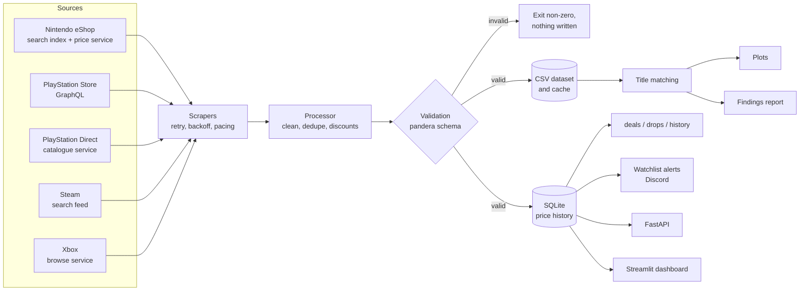
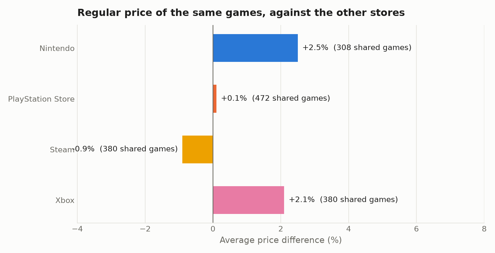
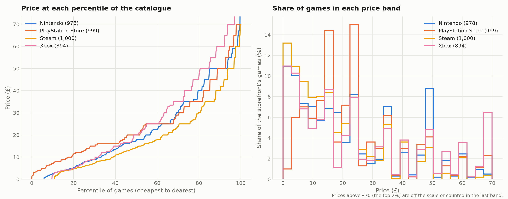
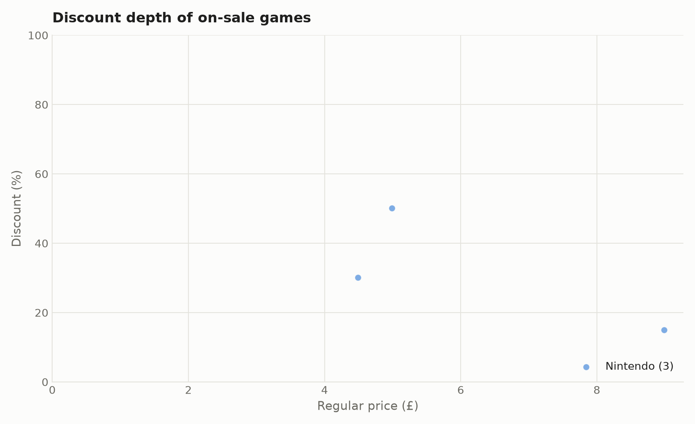
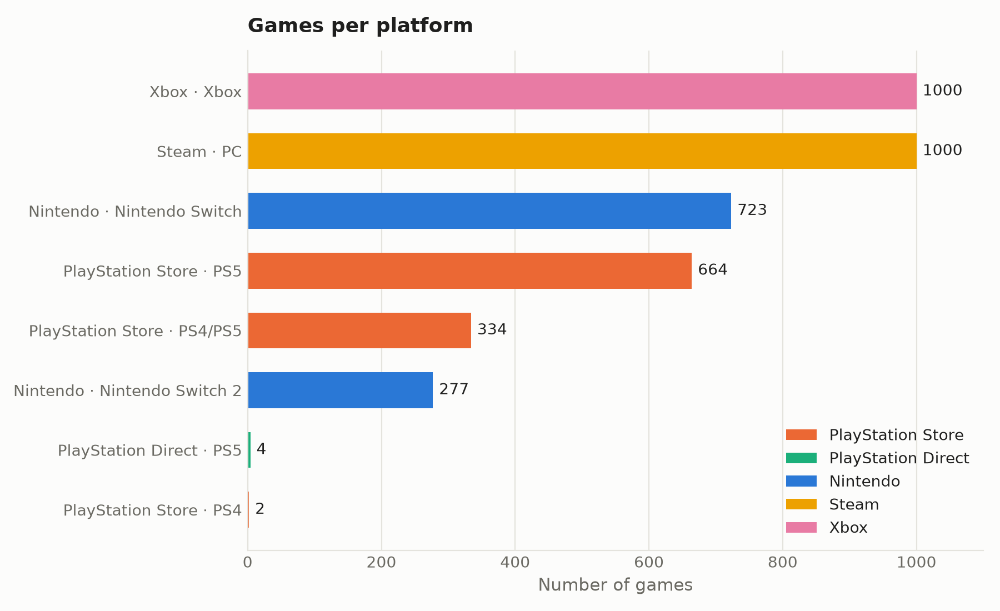

# GamePrice-Index


[](https://github.com/Furkan5E/GamePrice-Index/actions/workflows/test.yaml)


An automated ETL (Extract, Transform, Load) and market intelligence pipeline that collects, validates, stores and analyses UK video game prices across five storefronts: Nintendo eShop, PlayStation Store, PlayStation Direct, Steam and Xbox.

---

## Features

* **Five Storefronts, One Interface:** Every source implements the same `Scraper` contract and returns the same record shape, so adding a storefront is one class. Catalogues are read from the JSON services behind each site, with no browser automation.
* **Resilient Collection:** A shared `requests` session retries timeouts, rate limits and server errors with exponential backoff, paces its requests, and fails loudly: a source that errors or returns nothing stops the run with a non-zero exit code.
* **Validated ETL:** Records are cleaned with `pandas` and checked against a `pandera` schema (no negative prices, no sale price above the regular price, no rows without an id) before anything is cached, stored or plotted.
* **Price History:** A normalised `SQLite` schema keeps one price per game per day with upserts, and answers questions such as current deals, price drops and all-time lows.
* **Like-for-Like Comparison:** Titles are normalised and matched across stores, so the same game can be compared on regular price rather than comparing different catalogues.
* **Alerts:** A watchlist raises an alert when a game reaches a target price or a new all-time low, printed to the terminal and optionally posted to a Discord webhook.
* **API & Dashboard:** A read-only `FastAPI` service and a `Streamlit` dashboard sit on top of the same database.
* **Data Visualisation & Reporting:** Generates comparison plots with `matplotlib` and a written findings report from the data.
* **Offline Caching:** Supports cached execution (`--cached`) to rebuild the dataset, plots and report without any network requests.
* **Tested & Typed:** A `pytest` suite runs every scraper against saved copies of real responses, with `ruff` and `mypy` enforced in CI and as pre-commit hooks.
* **Containerised & Scheduled:** Runs in a small non-root Docker image, and a GitHub Actions workflow scrapes daily and publishes the growing history.

---

## Architecture



| Module | Responsibility |
| --- | --- |
| `scrapers/` | One class per storefront behind the shared `Scraper` interface. |
| `http_client.py` | The retrying, rate-limited HTTP session. |
| `processor.py` | Cleans records into the common dataset and computes discounts. |
| `validation.py` | The `pandera` schema every dataset must pass. |
| `storage.py` | SQLite schema, upserts and history queries. |
| `matching.py` | Title normalisation and cross-store matching. |
| `alerts.py` | Watchlist rules and Discord delivery. |
| `analysis.py`, `visualiser.py` | The findings report and the plots. |
| `api.py`, `dashboard.py` | The FastAPI service and the Streamlit app. |
| `cli.py` | The `gameprice-index` command. |

---

## Setup Instructions

Clone the repository and install dependencies using uv:
```bash
git clone https://github.com/Furkan5E/GamePrice-Index.git
cd GamePrice-Index
uv sync
```
Run the live scraping pipeline:
```bash
uv run gameprice-index
```
Run using cached local datasets:
```bash
uv run gameprice-index --cached
```
Command line options:

| Option | Description |
| --- | --- |
| `--cached` | Reuse the processed CSVs in `data/` instead of scraping. |
| `--source NAME` | Only include one storefront (`nintendo`, `playstation`, `playstation-direct`, `steam`, `xbox`); repeat for several. |
| `--no-plots` | Skip generating the plots. |
| `--output-dir DIR` | Directory that holds the `data/` and `plots/` folders. |
| `--db PATH` | SQLite database to record prices in. |
| `--limit N` | Most products to take from each storefront (default 1000, `0` for everything). |

Query the recorded price history:
```bash
uv run gameprice-index deals            # games on sale now, deepest discount first
uv run gameprice-index drops            # prices that fell since the previous scrape
uv run gameprice-index history 730      # every recorded price of one product
```

Serve the history as a JSON API (interactive docs at http://127.0.0.1:8000/docs):
```bash
uv sync --extra api
uv run gameprice-index serve
```

| Endpoint | Returns |
| --- | --- |
| `GET /games?source=&q=&limit=&offset=` | Games with their latest price. |
| `GET /games/{id}` | One game. |
| `GET /games/{id}/history` | Every recorded price of a game and its all-time low. |
| `GET /deals?source=&min_discount=` | Games on sale now, deepest discount first. |
| `GET /drops?min_drop=` | Prices that fell since the previous scrape. |
| `GET /sources` | Games tracked, games on sale and average price per storefront. |

Explore the history in a browser dashboard (deals, cross-store comparison, price history per game):
```bash
uv sync --extra dashboard
uv run gameprice-index dashboard
```

Run the test suite:
```bash
uv run pytest
```
Lint, format and type check (also available as pre-commit hooks via `uv run pre-commit install`):
```bash
uv run ruff check .
uv run ruff format .
uv run mypy
```
---
## Docker
Build the Docker image:
```bash
docker build -t gameprice-index .
```
Run the pipeline, mapping the output to your local `data/` and `plots/` directories:
```bash
docker run --rm -v "$(pwd)/data:/app/data" -v "$(pwd)/plots:/app/plots" gameprice-index
```
Anything after the image name is passed to the command, for example a cached run or the API:
```bash
docker run --rm -v "$(pwd)/data:/app/data" -v "$(pwd)/plots:/app/plots" gameprice-index --cached
docker run --rm -p 8000:8000 -v "$(pwd)/data:/app/data" gameprice-index serve --host 0.0.0.0
```
Pre-built container:
```bash
docker run --rm -v "$(pwd)/data:/app/data" -v "$(pwd)/plots:/app/plots" ghcr.io/furkan5e/gameprice-index:latest
```
---
## Analytics & Visualisations

The numbers below come from the committed dataset (4,004 games) and are reproduced by `uv run gameprice-index report`; the full write-up is in [reports/findings.md](reports/findings.md).

| Storefront | Games | Median price | On sale | Median discount |
| --- | --- | --- | --- | --- |
| Nintendo | 1,000 | £19.99 | 31.0% | 67.5% |
| PlayStation Store | 1,000 | £19.99 | 31.8% | 50.0% |
| Steam | 1,000 | £12.79 | 37.0% | 50.0% |
| Xbox | 1,000 | £20.61 | 20.6% | 50.0% |

* **Steam is the cheapest catalogue** by median price (£12.79) and has the largest share of games on sale (37%).
* **Nintendo discounts deepest:** when a game is on sale the typical cut is 67.5%, against 50% elsewhere. Xbox has the fewest games on sale (20.6%).
* **The same game usually costs the same everywhere.** Across 631 games matched on at least two stores, average regular prices differ by under 2% between storefronts; the gaps come from a minority of titles.
* **PlayStation Direct** sells only four physical titles in the UK, so it is tracked but left out of the comparisons.

### Same Games, Different Stores


### Price Distribution


### Discount Depth


### Catalogue by Platform


---
## Disclaimer

This tool was developed for educational and portfolio demonstration purposes only. All scraped data is the property of its respective platform holders.
